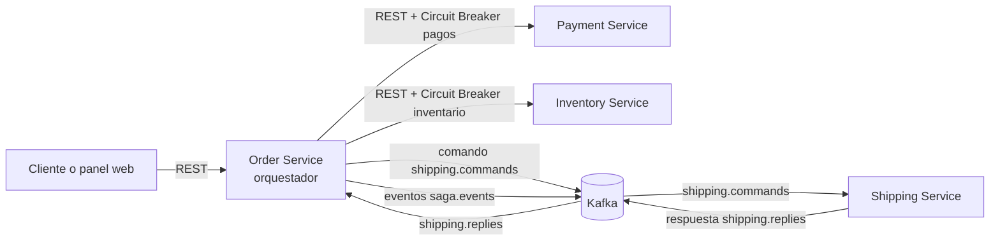
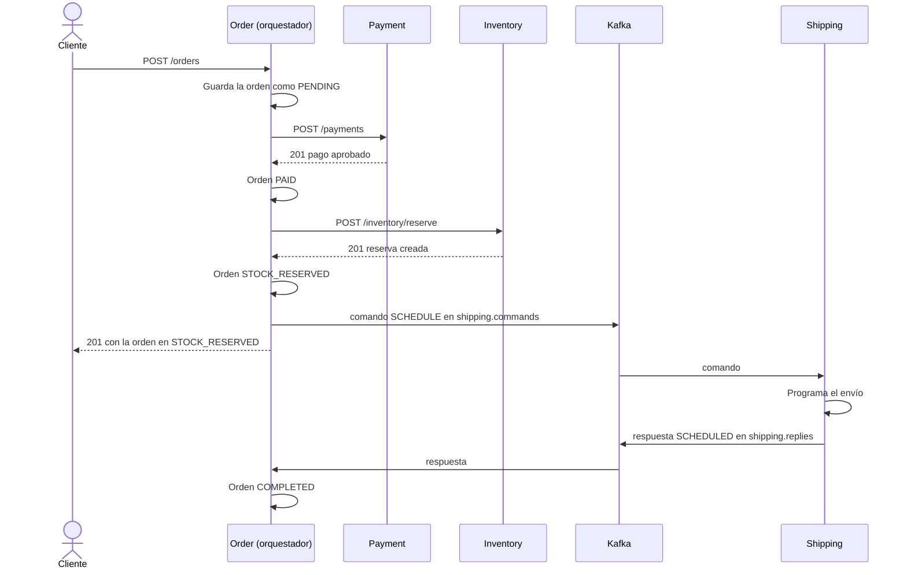
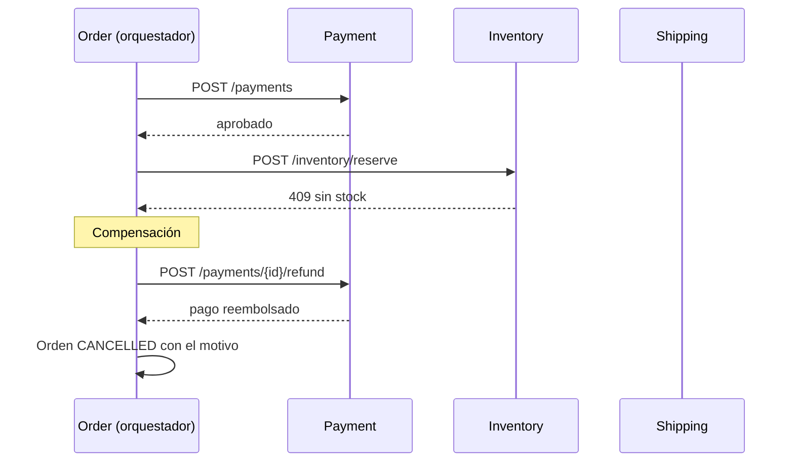
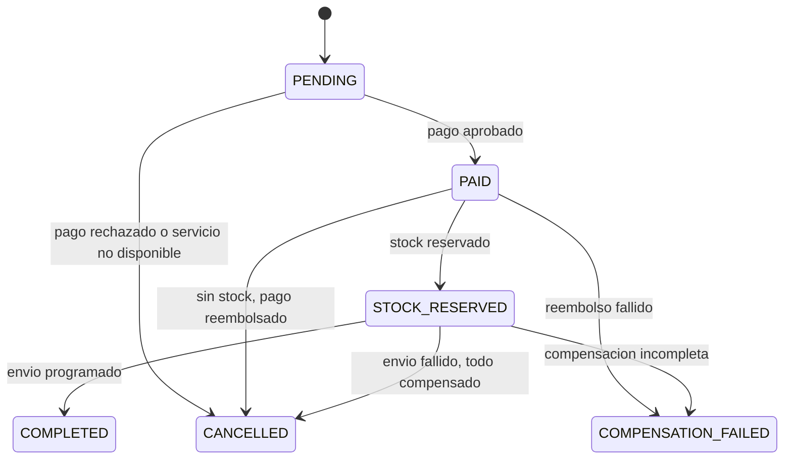
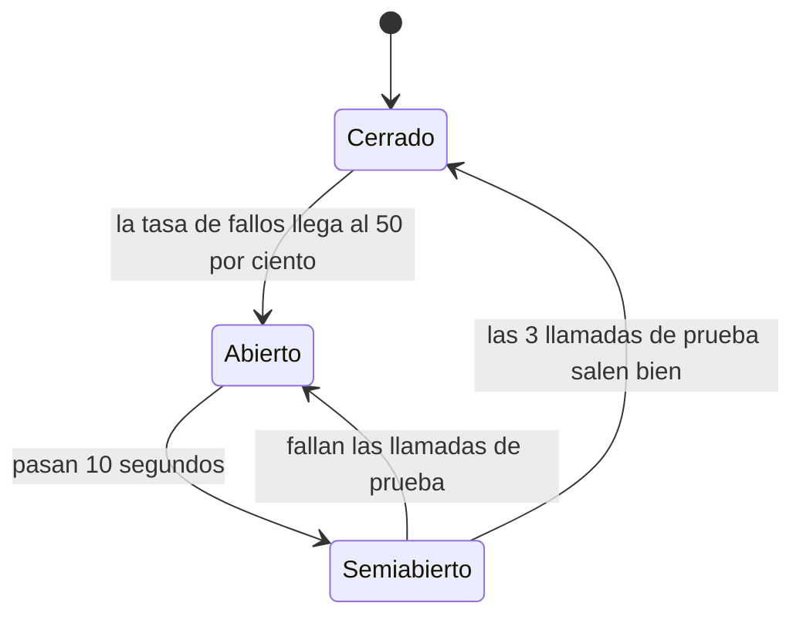

# Saga Pattern y Circuit Breaker Pattern: PoC con microservicios

Prueba de concepto de un flujo de compra de e-commerce con **cuatro microservicios** que demuestra dos patrones de resiliencia y consistencia:

- **Saga con orquestación y compensaciones**, para mantener la consistencia de los datos entre servicios sin transacciones distribuidas.
- **Circuit Breaker**, para evitar fallos en cascada cuando un servicio dependiente falla o se vuelve lento.

La saga se coordina desde un orquestador, la comunicación combina **REST** (pasos críticos, protegidos por Circuit Breaker) y **Kafka** (paso de envío, estado de la saga y trazabilidad), y un **panel web** permite disparar escenarios de fallo y ver el flujo en vivo.

---

## Tabla de contenido

1. [Arquitectura](#1-arquitectura)
2. [Tecnologías](#2-tecnologías)
3. [Estructura del repositorio](#3-estructura-del-repositorio)
4. [Patrón Saga](#4-patrón-saga)
5. [Patrón Circuit Breaker](#5-patrón-circuit-breaker)
6. [Contratos: REST y Kafka](#6-contratos-rest-y-kafka)
7. [Simulador de fallos](#7-simulador-de-fallos)
8. [Panel web de demostración](#8-panel-web-de-demostración)
9. [Escenarios de prueba](#9-escenarios-de-prueba)
10. [Saga vs Circuit Breaker: análisis](#10-saga-vs-circuit-breaker-análisis)

---

## 1. Arquitectura

### Escenario de negocio

Un flujo de compra con cuatro pasos, cada uno en su propio microservicio y con su propia base de datos:

1. **Order**: crea la orden.
2. **Payment**: cobra al cliente.
3. **Inventory**: descuenta el stock.
4. **Shipping**: programa el envío.

Si un paso falla, se ejecutan transacciones compensatorias en orden inverso (liberar stock, reembolsar el pago, cancelar la orden).

### Vista general



### Servicios

| Servicio | Puerto | Base de datos | Rol | Comunicación |
|---|---|---|---|---|
| `order-service` | 8081 | `order_db` | Dueño de la orden y **orquestador de la saga**; sirve el panel web | REST hacia Payment e Inventory (con Circuit Breaker); Kafka hacia Shipping |
| `payment-service` | 8082 | `payment_db` | Cobros y reembolsos | REST |
| `inventory-service` | 8083 | `inventory_db` | Stock y reservas | REST |
| `shipping-service` | 8084 | `shipping_db` | Programación y cancelación de envíos | REST y Kafka |

### Por qué REST para unos pasos y Kafka para otros

| Interacción | Canal | Motivo |
|---|---|---|
| Orquestador a **Payment** | REST + Circuit Breaker | Necesita saber de inmediato si el cobro fue aprobado o rechazado para decidir el siguiente paso. |
| Orquestador a **Inventory** | REST + Circuit Breaker | Mismo motivo: respuesta inmediata (hay stock o no). |
| Compensaciones (reembolso, liberación) | REST + reintentos | Órdenes directas, idempotentes, que deben insistir hasta lograrse. |
| Orquestador a **Shipping** | Kafka (comando y respuesta) | Último paso, el cliente no necesita esperar; muestra una saga con respuestas asíncronas. |
| Estado de la saga | Kafka (`saga.events`) | Trazabilidad y auditoría de cada transición. |

El Circuit Breaker protege **llamadas síncronas**: en una comunicación puramente por eventos no hay una llamada que proteger. Por eso Payment e Inventory van por REST y cada uno tiene su propio Circuit Breaker.

---

## 2. Tecnologías

| Componente | Tecnología |
|---|---|
| Lenguaje y framework | Java 17 o superior (requisito de Spring Boot 4), **Spring Boot 4.1.1**, Maven |
| Persistencia | PostgreSQL, Spring Data JPA, **Flyway** para migraciones |
| Mensajería | **Apache Kafka 4.3.1** (modo KRaft, sin ZooKeeper), Spring for Apache Kafka |
| Circuit Breaker | **Resilience4j** mediante Spring Cloud Circuit Breaker |
| Cliente HTTP | `RestClient` de Spring |
| Utilidades | Lombok, Bean Validation, Spring Boot Actuator |
| Panel web | HTML, CSS y JavaScript sin dependencias, servido como recurso estático |

La configuración de cada servicio está en su `application.properties`. Las clases de servicio siguen el patrón **interfaz + implementación** (`OrderService` y `OrderServiceImpl`, y así en los demás).

---

## 3. Estructura del repositorio

```
.
├── README.md
├── order-service/
│   ├── pom.xml
│   └── src/main/
│       ├── java/.../orderservice/
│       │   ├── client/        clientes REST (Payment, Inventory) y StepResult
│       │   ├── config/        Circuit Breakers y monitor de estado
│       │   ├── controller/    OrderController, CircuitBreakerAdminController, DemoController
│       │   ├── dto/  entity/  enums/  exception/  repository/
│       │   ├── messaging/     records de Kafka, publicadores, listener, SagaEventStore
│       │   ├── saga/          OrderSagaOrchestrator
│       │   └── service/ + service/impl/
│       └── resources/
│           ├── application.properties
│           ├── db/migration/  V1 (orders), V2 (payment_id y shipping_id)
│           └── static/index.html   panel web
├── payment-service/
├── inventory-service/
└── shipping-service/
```

Cada microservicio es un proyecto Maven independiente. Los nombres de carpeta pueden ajustarse a los que uses en tu repositorio.

---

## 4. Patrón Saga

### 4.1 El problema

Cada servicio tiene su propia base de datos, así que no se puede usar una transacción ACID única. El protocolo clásico para transacciones distribuidas, **2PC (two-phase commit)**, es bloqueante, depende de un coordinador que es punto único de falla y escala mal.

### 4.2 La solución

Una **saga** es una secuencia de **transacciones locales**. Cada servicio confirma su parte en su propia base de datos. Si un paso falla, no hay un rollback global: se ejecutan **transacciones compensatorias** que deshacen de forma semántica lo ya confirmado. El resultado es **consistencia eventual**: durante la saga existen estados intermedios visibles (por ejemplo, orden pagada pero sin stock confirmado) y al final el sistema queda consistente.

### 4.3 Orquestación (enfoque elegido)

Un **orquestador** (la clase `OrderSagaOrchestrator`, dentro del Order Service) conoce el flujo completo, ordena cada paso y decide qué compensar ante un fallo.

| | Coreografía | **Orquestación (elegida)** |
|---|---|---|
| Control del flujo | Repartido: cada servicio reacciona a eventos | Centralizado en el orquestador |
| Visibilidad del flujo | Difícil de seguir | Explícita en un solo lugar |
| Acoplamiento | Bajo | Mayor hacia el orquestador |
| Riesgo | Dependencias cíclicas entre eventos | El orquestador puede crecer demasiado |

Se eligió orquestación porque con cuatro pasos y compensaciones ordenadas es más fácil de explicar, probar y depurar.

### 4.4 Flujo exitoso



La respuesta del `POST /orders` llega con la orden en `STOCK_RESERVED`, porque el envío es asíncrono. El estado final `COMPLETED` se obtiene consultando `GET /orders/{id}` unos instantes después (el panel web lo hace automáticamente).

### 4.5 Flujos con fallo y compensaciones

| Falla | Compensaciones (en orden inverso) | Estado final de la orden |
|---|---|---|
| Pago rechazado (422) o Payment no disponible | Ninguna: nunca se cobró | `CANCELLED` |
| Sin stock (409) o Inventory no disponible | Reembolsar el pago | `CANCELLED` |
| Shipping responde `FAILED` | Liberar el stock, reembolsar el pago | `CANCELLED` |
| Una compensación falla tras 3 intentos | Queda incompleta | `COMPENSATION_FAILED` |



Si el fallo viene de Shipping (respuesta `FAILED` por Kafka), el orquestador libera el stock con `POST /inventory/release`, reembolsa el pago y cancela la orden.

### 4.6 Estados de la orden



### 4.7 Transacciones compensatorias

| Paso | Acción | Compensación |
|---|---|---|
| Order | `POST /orders` | `DELETE /orders/{id}` (cancela la orden) |
| Payment | `POST /payments` | `POST /payments/{id}/refund` |
| Inventory | `POST /inventory/reserve` | `POST /inventory/release` |
| Shipping | `POST /shipping/schedule` o comando `SCHEDULE` | `DELETE /shipping/{id}` o comando `CANCEL` |

Una compensación **no es un rollback**: el cobro existió y se registra un reembolso; no se borra el cobro.

### 4.8 Propiedades que garantizan la robustez

- **Idempotencia.** Los pagos, las reservas y los envíos tienen una restricción `UNIQUE` sobre `order_id`. Repetir una petición o recibir un comando duplicado de Kafka (que entrega *al menos una vez*) devuelve el mismo resultado sin duplicar efectos. Reembolsar o liberar dos veces tampoco cambia nada.
- **Respuesta siempre presente.** Shipping responde `FAILED` ante cualquier excepción, para que el orquestador pueda compensar en lugar de esperar indefinidamente.
- **Respuestas duplicadas o tardías.** El orquestador solo actúa si la orden sigue en `STOCK_RESERVED`; en otro estado ignora la respuesta.
- **Sin transacciones largas.** El orquestador no es `@Transactional`: cada paso confirma su propia transacción local, y nunca se mantiene una transacción abierta durante una llamada HTTP.
- **Estado antes del mensaje.** La orden pasa a `STOCK_RESERVED` *antes* de publicar el comando a Shipping, para que la respuesta asíncrona siempre encuentre la orden lista.
- **Compensaciones con reintentos.** Se intentan hasta 3 veces con espera creciente; si siguen fallando, la orden queda en `COMPENSATION_FAILED` para intervención manual.

---

## 5. Patrón Circuit Breaker

### 5.1 El problema

Si un servicio dependiente está lento o caído y se siguen enviando llamadas, los hilos del llamador quedan esperando, se agotan los recursos y el llamador también falla; a su vez, quien lo llama cae también: un **fallo en cascada**.

### 5.2 La solución

Como el interruptor automático de una casa: tras detectar demasiados fallos, el circuito se **abre** y las llamadas se rechazan de inmediato (con un *fallback*) sin tocar al servicio dañado, dándole tiempo de recuperarse.

### 5.3 Estados



| Estado | Comportamiento |
|---|---|
| **Cerrado** (Closed) | Las llamadas pasan y se miden. Si la tasa de fallos supera el umbral, pasa a Abierto. |
| **Abierto** (Open) | Rechaza las llamadas de inmediato y ejecuta el fallback. Tras el tiempo de espera, pasa a Semiabierto. |
| **Semiabierto** (Half-Open) | Permite unas pocas llamadas de prueba: si salen bien, vuelve a Cerrado; si fallan, regresa a Abierto. |

### 5.4 Configuración

Hay **dos Circuit Breakers** (`paymentCB` e `inventoryCB`), configurados en `ResilienceConfiguration`:

| Parámetro | Valor | Origen |
|---|---|---|
| `failureRateThreshold` | 50 % | Requisito de la práctica |
| `slidingWindowSize` | 10 | Requisito de la práctica |
| `waitDurationInOpenState` | 10 s | Requisito de la práctica |
| `permittedNumberOfCallsInHalfOpenState` | 3 | Requisito de la práctica |
| `minimumNumberOfCalls` | 5 | Elegido: el circuito se evalúa desde la quinta llamada |
| `automaticTransitionFromOpenToHalfOpenEnabled` | `true` | Elegido: pasa solo a semiabierto sin esperar otra llamada |
| Timeout por llamada (`TimeLimiter`) | 2 s | Elegido: una llamada más lenta cuenta como fallo |

### 5.5 Qué cuenta como fallo y qué no

Es la decisión de diseño más importante del Circuit Breaker en esta PoC:

| Tipo | Ejemplos | Respuesta | ¿Cuenta como fallo del circuito? |
|---|---|---|---|
| **Fallo de negocio** | Sin stock, pago rechazado | 4xx (409, 422) | **No**: el servicio funciona y solo respondió "no" |
| **Fallo técnico** | Servicio caído, error interno, lento | 5xx, timeout, conexión rechazada | **Sí** |

Si un "sin stock" abriera el circuito, un caso de negocio normal bloquearía el sistema. Por eso los 4xx **no se lanzan como excepción** dentro del Circuit Breaker: el cliente devuelve un resultado (`StepResult` con `BUSINESS_FAILURE`) y el circuito lo ve como una llamada exitosa. Esos casos activan la **saga**, mientras que los fallos técnicos activan el **Circuit Breaker**.

### 5.6 Fallback

Cuando el circuito está abierto, o la llamada falla o hace timeout, se devuelve una respuesta controlada en lugar de propagar el error:

- *"Servicio de pagos no disponible, intente más tarde"*
- *"Servicio de inventario no disponible (circuito abierto), intente más tarde"*

El orquestador la trata como un paso fallido y aplica la política de la saga correspondiente (cancelar, con o sin compensaciones).

### 5.7 Las compensaciones no pasan por el Circuit Breaker

Reembolsar y liberar stock deben intentarse siempre, aunque el circuito de ese servicio esté abierto, por lo que usan llamadas directas con reintentos. Si el servicio realmente está caído, tras 3 intentos la orden queda en `COMPENSATION_FAILED`.

### 5.8 Patrones complementarios

| Patrón | Estado en esta PoC |
|---|---|
| **Timeout** | Implementado (2 s por llamada) |
| **Fallback** | Implementado (mensaje controlado) |
| **Retry** | Implementado solo para compensaciones |
| **Bulkhead** | No implementado |

---

## 6. Contratos: REST y Kafka

### 6.1 Endpoints REST

**Order Service (8081)**

| Método y ruta | Descripción |
|---|---|
| `POST /orders` | Crea la orden e inicia la saga. Cuerpo: `customerId`, `productId`, `quantity`, `unitPrice` |
| `GET /orders` | Lista las órdenes |
| `GET /orders/{id}` | Consulta una orden |
| `DELETE /orders/{id}` | Compensación de Order: marca la orden como `CANCELLED` (solo cambia el estado) |
| `GET /admin/circuit-breakers` | Estado de los dos Circuit Breakers |

**Payment Service (8082)**

| Método y ruta | Descripción |
|---|---|
| `POST /payments` | Cobra una orden. Cuerpo: `orderId`, `customerId`, `amount`. Rechaza montos mayores a 10 000 con 422 |
| `POST /payments/{id}/refund` | Reembolsa un pago (idempotente) |
| `GET /payments/{id}` | Consulta un pago |

**Inventory Service (8083)**

| Método y ruta | Descripción |
|---|---|
| `POST /inventory/reserve` | Reserva stock. Cuerpo: `orderId`, `productId`, `quantity`. Responde 409 si no hay stock y 404 si el producto no existe |
| `POST /inventory/release` | Libera la reserva de una orden. Cuerpo: `orderId` (idempotente) |
| `GET /inventory/{productId}` | Consulta el stock disponible |

Productos de prueba (sembrados por Flyway): `prod-001` con 100 unidades, `prod-002` con 5 y `prod-003` con 0 (para forzar el caso sin stock).

**Shipping Service (8084)**

| Método y ruta | Descripción |
|---|---|
| `POST /shipping/schedule` | Programa un envío. Cuerpo: `orderId`, `customerId`, `productId`, `quantity` |
| `DELETE /shipping/{id}` | Cancela un envío (idempotente) |
| `GET /shipping/{id}` | Consulta un envío |

### 6.2 Tópicos de Kafka

| Tópico | Productor | Consumidor | Contenido |
|---|---|---|---|
| `shipping.commands` | Order | Shipping | Comandos `SCHEDULE` y `CANCEL` |
| `shipping.replies` | Shipping | Order | Resultado: `SCHEDULED`, `CANCELLED` o `FAILED` |
| `saga.events` | Order | (auditoría) | Cada transición de la saga |
| `order.retry` | (reservado) | (reservado) | Cola de reintentos, aún sin implementar |

La clave de cada mensaje es el `orderId`, de modo que los mensajes de una misma orden conservan su orden relativo.

### 6.3 Mensajes

El **JSON es el contrato** entre servicios: no se envían cabeceras con nombres de clases Java, y cada servicio deserializa a su propio tipo. Los nombres de campo deben coincidir.

Comando a Shipping (`shipping.commands`):

```json
{
  "action": "SCHEDULE",
  "orderId": "39768a1e-df32-4106-aeaf-5baded4398ab",
  "customerId": "cli-001",
  "productId": "prod-001",
  "quantity": 2
}
```

Respuesta de Shipping (`shipping.replies`):

```json
{
  "orderId": "39768a1e-df32-4106-aeaf-5baded4398ab",
  "shippingId": "f25483a9-4dd7-4c65-a658-8596792e2be2",
  "status": "SCHEDULED",
  "reason": null
}
```

Evento de la saga (`saga.events`):

```json
{
  "orderId": "39768a1e-df32-4106-aeaf-5baded4398ab",
  "event": "PAYMENT_COMPLETED",
  "detail": null,
  "occurredAt": "2026-10-03T16:41:22.205Z"
}
```

Eventos posibles: `ORDER_CREATED`, `PAYMENT_COMPLETED`, `PAYMENT_FAILED`, `STOCK_RESERVED`, `STOCK_FAILED`, `SHIPPING_REQUESTED`, `ORDER_COMPLETED`, `SHIPPING_FAILED`, `COMPENSATION_STARTED`, `STOCK_RELEASED`, `PAYMENT_REFUNDED`, `ORDER_CANCELLED` y `COMPENSATION_FAILED`.

---

## 7. Simulador de fallos

Cada servicio (Payment, Inventory y Shipping) expone `/admin/fail-mode` para provocar fallos en vivo, sin tocar código:

```bash
curl -X POST http://localhost:8082/admin/fail-mode -H "Content-Type: application/json" -d '{"mode":"ERROR"}'
```

| Modo | Efecto |
|---|---|
| `NORMAL` | Responde con normalidad |
| `ERROR` | Los endpoints de negocio responden **503**. En Shipping, el listener de Kafka responde `FAILED` |
| `SLOW` | Retrasa la respuesta (3 s por defecto, ajustable con `delayMs`), por encima del timeout de 2 s del Circuit Breaker |

Además de estos fallos técnicos, hay fallos de **negocio** que se provocan con datos: `prod-003` (sin stock) y un monto superior a 10 000 (pago rechazado).

> Los endpoints `/admin` y `/demo` existen solo para fines didácticos de la PoC y no están protegidos. No deben exponerse en un entorno real.

---

## 8. Panel web de demostración

Con el Order Service en marcha, abre **http://localhost:8081/**.

- **Recorrido de la orden:** los cuatro servicios como nodos unidos por cables que cambian de color (verde, éxito; rojo, fallo; ámbar con flecha hacia atrás, compensación; azul animado, esperando respuesta).
- **Interruptores de Circuit Breaker** sobre los cables hacia Payment e Inventory, que cambian de posición según el estado real del circuito.
- **Línea de tiempo** con los eventos de la saga, con hora al milisegundo y el motivo de cada fallo.
- **Escenarios con un clic:** compra exitosa, producto sin stock, pago rechazado y una ráfaga de 7 órdenes.
- **Fallos simulados** (Normal, Error o Lento) para los tres servicios y un botón para restaurarlos.
- **Circuit breakers:** ventana de las últimas 10 llamadas, tasa de fallos y cuenta regresiva aproximada hacia semiabierto.
- **Stock actual** y **tabla de órdenes** con su estado y motivo de cancelación.

El panel solo habla con el Order Service. Los endpoints `/demo/*` reenvían las peticiones a los otros servicios, por lo que no se requiere configurar CORS.

---

## 9. Escenarios de prueba

### 9.1 Saga

| # | Escenario | Cómo provocarlo | Resultado esperado |
|---|---|---|---|
| 1 | **Flujo exitoso** | Crear una orden de `prod-001` | La orden termina en `COMPLETED`, con `paymentId` y `shippingId`; el stock baja |
| 2 | **Sin stock** | Crear una orden de `prod-003` | `CANCELLED` con motivo HTTP 409; el pago queda `REFUNDED` |
| 3 | **Pago rechazado** | Crear una orden con un precio unitario de 20 000 | `CANCELLED` con motivo HTTP 422; no hay reembolso porque nunca se cobró |
| 4 | **Fallo asíncrono de Shipping** | Shipping en modo `ERROR` y crear una orden | Termina en `CANCELLED`; el stock vuelve a su valor original y el pago queda `REFUNDED` |

### 9.2 Circuit Breaker

| # | Escenario | Cómo provocarlo | Resultado esperado |
|---|---|---|---|
| 5 | **Apertura del circuito** | Payment en `ERROR` y enviar 7 órdenes | Las primeras 5 fallan con "Servicio de pagos no disponible"; el circuito se abre; las órdenes 6 y 7 fallan al instante con "(circuito abierto)" sin llamar a Payment |
| 6 | **Recuperación** | Payment en `NORMAL`, esperar 10 s y enviar 3 órdenes | El circuito pasa a semiabierto y, con las 3 llamadas de prueba exitosas, vuelve a cerrado |
| 7 | **Lentitud** | Payment en `SLOW` | Las llamadas hacen timeout (límite de 2 s), cuentan como fallos y abren el circuito |
| 8 | **Segundo Circuit Breaker** | Inventory en `ERROR` y enviar órdenes | Se abre `inventoryCB`; además cada orden dispara el reembolso del pago ya realizado |

### 9.3 Dónde observar el resultado

- **Panel web:** recorrido de la orden, interruptores y línea de tiempo.
- **Log del Order Service:** transiciones del circuito, por ejemplo `[CB:paymentCB] ... CLOSED_TO_OPEN`.
- **Kafka**, para ver los eventos de la saga:

  ```bash
  bin/kafka-console-consumer.sh --bootstrap-server localhost:9092 --topic saga.events --from-beginning
  ```

---

## 10. Saga vs Circuit Breaker: análisis

Son patrones **complementarios**: la saga protege la **consistencia** de los datos y el Circuit Breaker protege la **disponibilidad** del sistema.

| | Saga | Circuit Breaker |
|---|---|---|
| **Protege** | La consistencia entre servicios | La disponibilidad frente a dependencias fallidas |
| **Reacciona ante** | Fallos de negocio o de un paso | Fallos técnicos o de infraestructura |
| **Mecanismo** | Transacciones compensatorias | Cortar llamadas y responder con un fallback |
| **Resultado** | Estado final consistente | Fallo rápido y controlado, sin cascada |

### Saga

| Ventajas | Desventajas |
|---|---|
| No bloquea recursos como 2PC | Solo ofrece consistencia eventual: hay estados intermedios visibles |
| Cada servicio conserva su base de datos | Las compensaciones son lógica extra y deben ser idempotentes |
| Escala bien y tolera fallos parciales | Más difícil de depurar; requiere trazabilidad (eventos) |

**Cuándo usarla:** operaciones de negocio que cruzan varios servicios y donde la consistencia eventual es aceptable (compras, reservas, onboarding). **Cuándo evitarla:** cuando se exige consistencia estricta e inmediata, o cuando las acciones no se pueden compensar.

### Circuit Breaker

| Ventajas | Desventajas |
|---|---|
| Evita fallos en cascada y agotamiento de recursos | Mal configurado puede abrirse sin necesidad o tardar en detectar fallos |
| Falla rápido en lugar de esperar timeouts largos | Hay que diseñar un fallback significativo para cada caso |
| Da tiempo al servicio dañado para recuperarse | Añade estado y configuración que mantener y monitorear |

**Cuándo usarlo:** llamadas síncronas a servicios o dependencias externas que pueden fallar o degradarse. **Cuándo evitarlo:** comunicación puramente asíncrona por eventos, o llamadas locales dentro de un mismo proceso.

---

